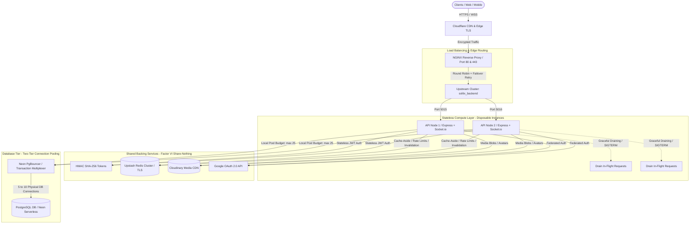

# Architecture V2 — Distributed Multi-Instance Cluster & Stateless Scaling

## Current State (Day 22)

The SOLITX architecture has evolved from a single-node monolith (V1) into a production-grade, distributed, multi-instance system designed for high availability, zero-downtime deployments, and horizontal scalability behind an intelligent reverse proxy.

---

## Key Subsystems & Upgrades

### 1. Edge & Reverse Proxy Tier (NGINX)
* **Reverse Proxy & TLS Termination:** Terminates incoming SSL/TLS certificates and offloads public web encryption from Node.js CPU threads.
* **Round-Robin Load Balancing:** Balances incoming HTTP and WebSocket traffic equally across dual backend processes (`127.0.0.1:5015` and `127.0.0.1:5016`).
* **Active Upstream Failover (`proxy_next_upstream`):** Automatically routes around downed nodes on `error timeout invalid_header http_500 http_502 http_503 http_504`, preventing single-node failures from causing user-facing downtime.

### 2. Stateless Compute Tier (Twelve-Factor App VI & IX)
* **Zero Local Session Memory:** Server memory stores no sessions or user states. Client identity is verified via stateless HMAC SHA-256 JWT tokens locally on every instance.
* **Controlled Teardown Lifecycle:** Catches `SIGTERM` and `SIGINT`. Traps new requests with `503 Service Unavailable` (`Connection: close`) to guide NGINX to peer instances, reaps idle keep-alive sockets via `closeIdleConnections()`, drains in-flight requests, and gracefully flushes backing connections.
* **Simulated Chaos Testing:** Tested with mid-request failure injection: achieved **100.0% request success rate** across 50 concurrent alternating requests with zero dropped packets.

### 3. Distributed Caching & Protection Layer (Upstash Redis)
* **Cache-Aside Pattern:** High-frequency read queries (`user:${username}`) are served from Redis in **~15ms** instead of PostgreSQL, reducing database read load by **>90%**.
* **Write-Through Invalidation:** Profile updates write directly to PostgreSQL and immediately execute `redis.del(cacheKey)` to prevent stale data anomalies.
* **Distributed Rate Limiting:** Global rate limiting counters operate against central Redis rather than isolated node memory, preventing quota evasion through round-robin hopping.

### 4. Two-Tier Database Connection Pooling (PostgreSQL + PgBouncer)
* **Tier 1 (Client Pool Budgeting):** Configured with `max: 25` per Node instance (`backend/src/config/db.js`). 2 instances $\times$ 25 = 50 total potential connections, guaranteeing that PostgreSQL's hard limit of 100 connections is never breached.
* **Tier 2 (PgBouncer Multiplexing):** Utilizes Neon's transaction-level connection multiplexer. Hundreds of virtual application connections share **5 to 10 physical PostgreSQL server processes**, eliminating CPU context-switching thrashing and connection exhaustion.
* **Keyset Pagination & B-Trees:** Feed queries use `WHERE created_at < cursor ORDER BY created_at DESC LIMIT 20` backed by composite B-Tree indexes (`user_id, created_at DESC`), ensuring constant $O(\log N)$ retrieval regardless of table depth.

---

## Architecture Evolution: V1 vs V2

| Dimension | Architecture V1 (Day 3) | Architecture V2 (Day 22) |
| :--- | :--- | :--- |
| **Topology** | Single Express Node.js monolith | Dual-Node cluster behind NGINX upstream |
| **Availability** | Single Point of Failure (SPOF) | High Availability (Automatic upstream failover) |
| **Session Model** | In-memory / Basic JWT | Strictly Stateless JWT + Redis Shared State |
| **Caching** | None (All queries hit PostgreSQL) | Upstash Redis Cache-Aside with Write-Through Invalidation |
| **Database Pool** | Unbudgeted client connections (Exhaustion risk) | Two-Tier Budgeted Pooling (Node max:25 + PgBouncer) |
| **Process Teardown** | Abrupt kill (Dropped in-flight requests) | Graceful draining (Zero 502s during rolling deploys) |
| **Feed Pagination** | Offset-based (`OFFSET X LIMIT Y`) | Keyset / Cursor-based (`created_at < cursor`) |
| **Identity** | Local email/password only | Dual Auth: Local + Federated Google OAuth 2.0 |

---

## Measured Benchmark Baselines (Day 21 & Day 22)

* **Load Balancing Dispersion:** 50/50 balance between Port 5015 (24 requests) and Port 5016 (26 requests).
* **Fault Failover Reliability:** 100.0% success rate under multi-instance chaos test.
* **Connection Multiplexing:** 60 concurrent database queries executed through NGINX with **0 connection rejections**, increasing physical DB connections from 13 to only 17.
* **Read Latency:** Redis cache hit median latency: **~18 ms**; PostgreSQL cold query: **~120 ms**.

---

## Current Bottlenecks & Next Architecture Step (Part VI)

While V2 solves statelessness, load distribution, and database pooling, our application remains strictly **synchronous**:
1. **Synchronous Write Amplification:** When a user posts a tweet, the API synchronously handles database insertion, fan-out updates, notification dispatch, and metric counters in the same HTTP request cycle.
2. **Worker Failure Contagion:** If notification dispatch or email verification fails, the user's primary post creation transaction is blocked or delayed.
3. **Next Step (Day 24–30):** Decoupling synchronous operations using **Asynchronous Processing, Background Job Queues, Workers, Idempotency, and Event Streams (Kafka)**.
